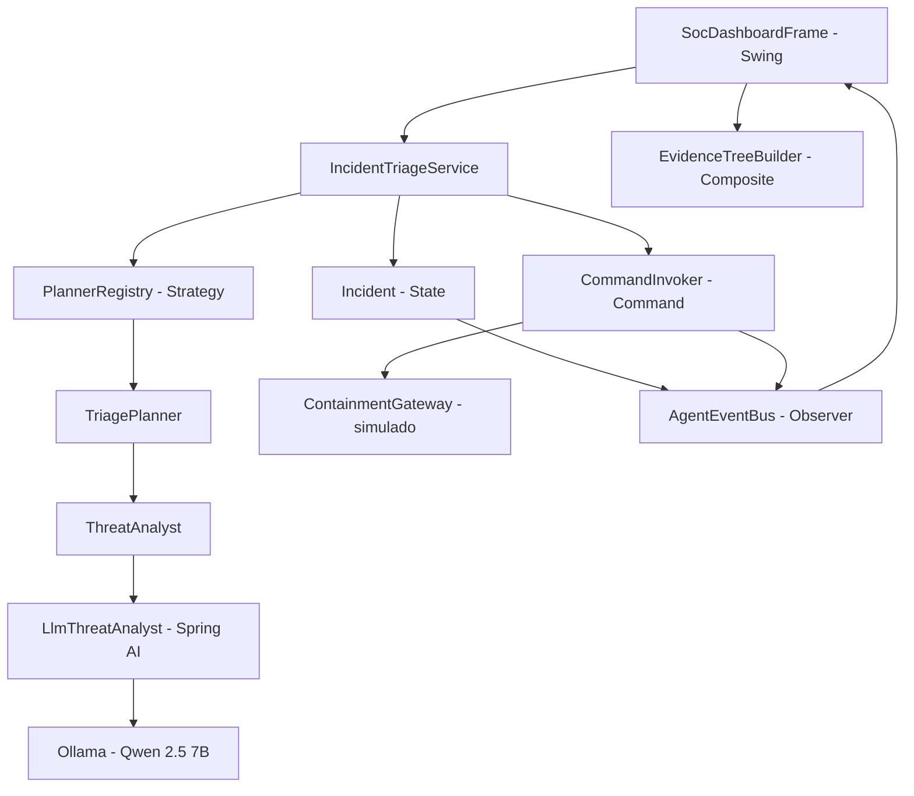
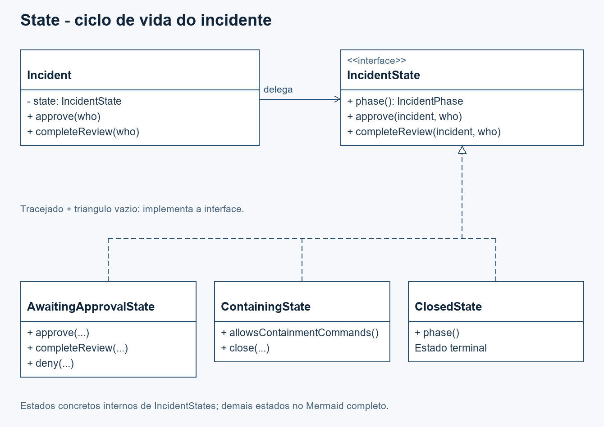
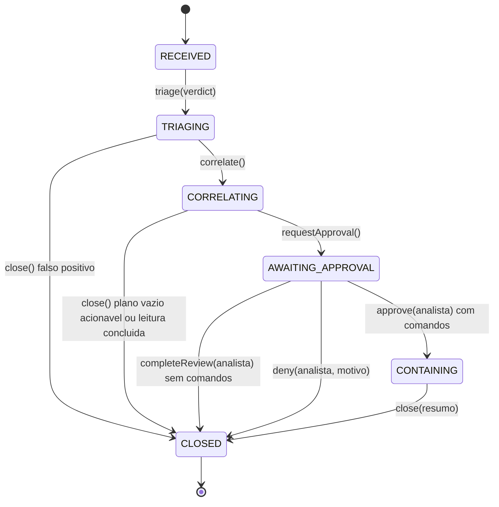
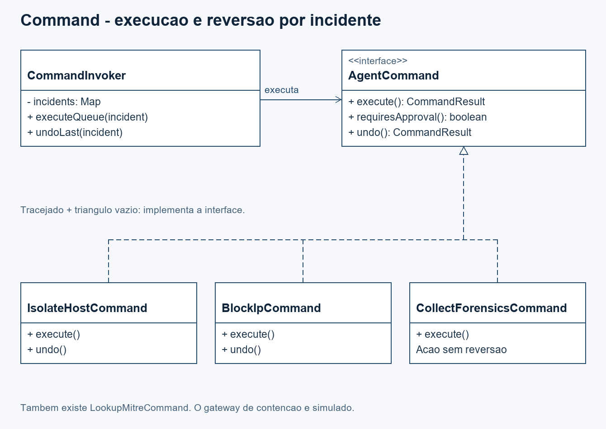
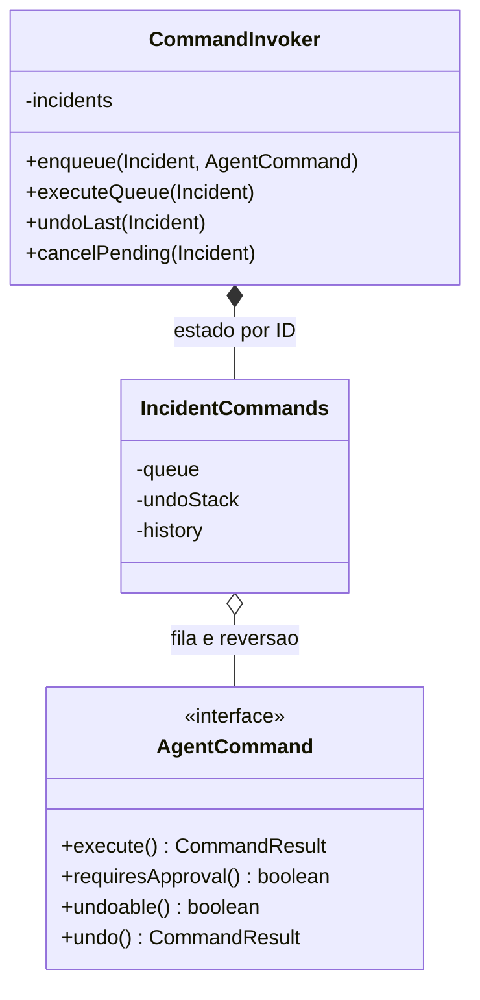
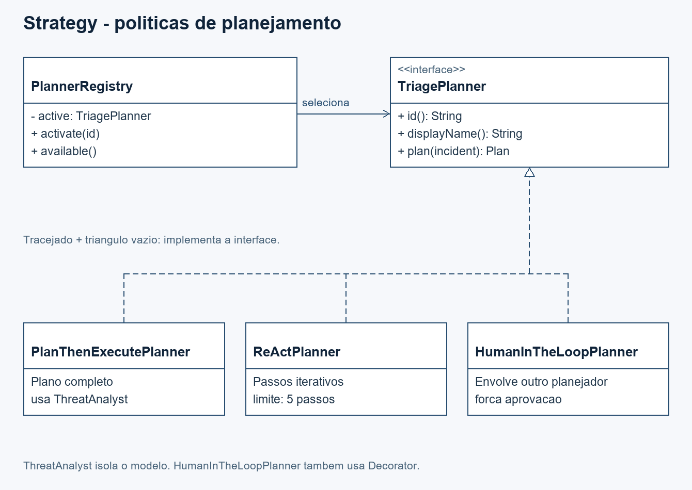
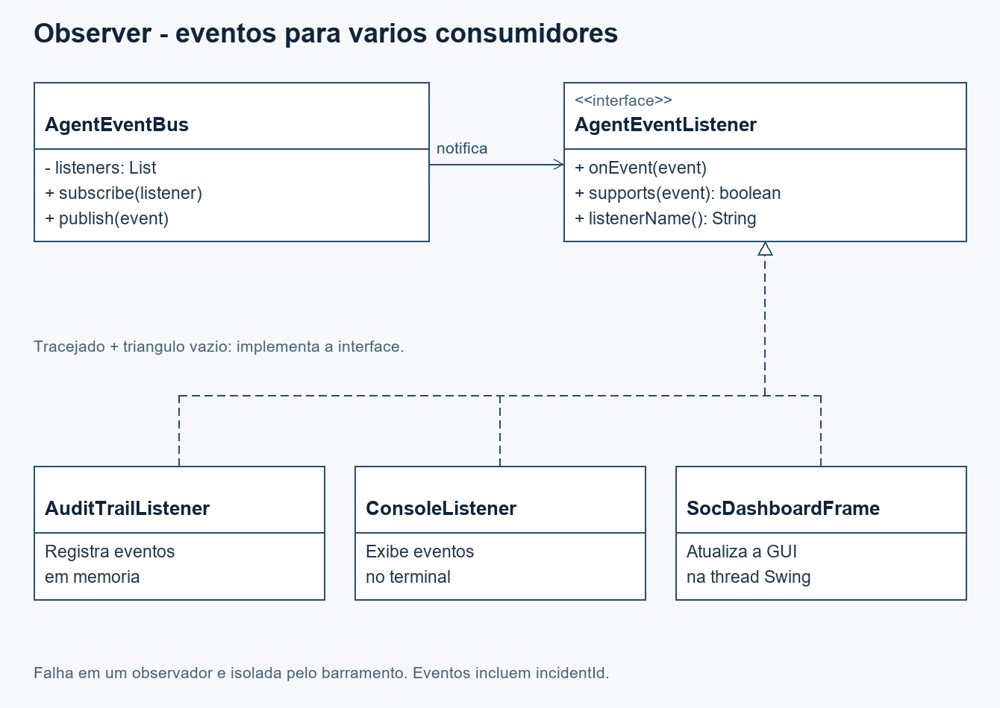
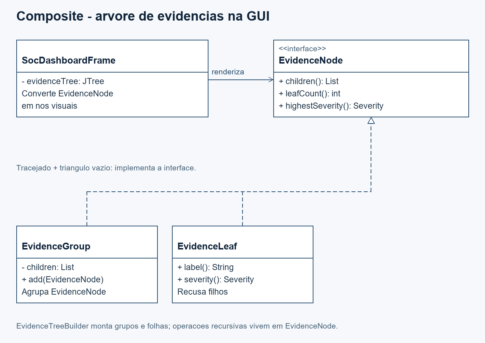
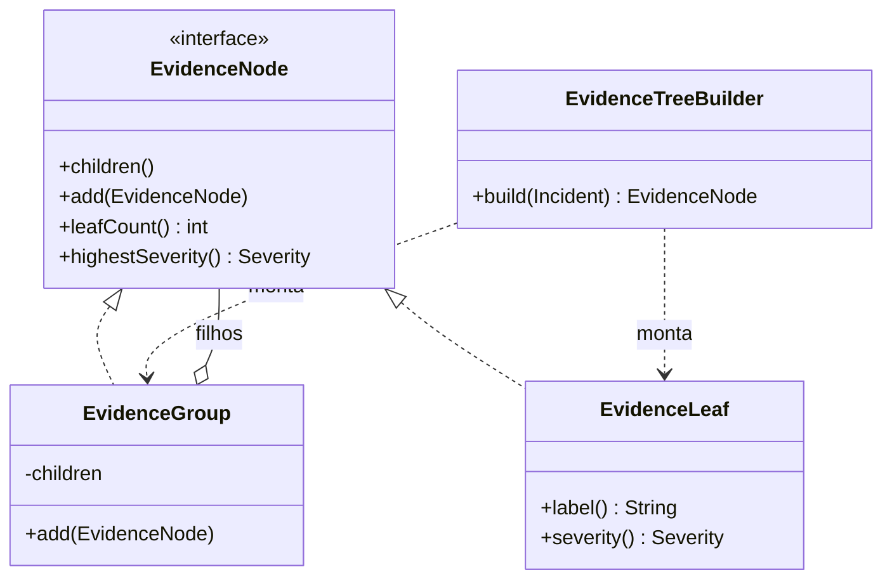
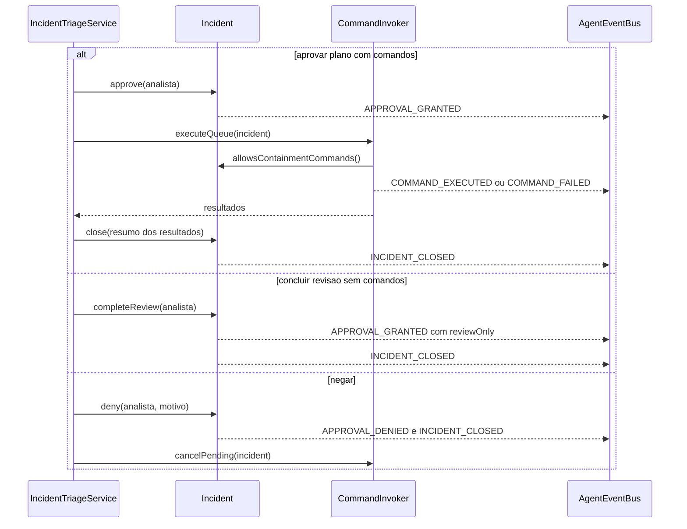

# Arquitetura e padrões de projeto

Aplicação Java desktop da categoria Security Agents. Spring AI consulta um modelo aberto pelo Ollama; a interface Swing apresenta alertas fictícios, veredito, evidências e decisão humana. Contenção e coleta são simuladas em memória.

## Visão geral

| Camada | Classes e pacotes | Responsabilidade |
|---|---|---|
| Apresentação | SocDashboardFrame, gui/component, gui/tree | Controles, eventos, árvore e detalhes selecionáveis |
| Aplicação | IncidentTriageService, PlannerRegistry | Abrir incidente, planejar e coordenar decisão/execução |
| Domínio e padrões | state, command, strategy, observer | Estados, ferramentas, estratégias e notificações |
| Integrações | LlmThreatAnalyst, SimulatedContainmentGateway, MitreRepository | Modelo, simulação e catálogo MITRE local |



O diagrama de camadas resume dependências; as interfaces permitem substituir o modelo e o gateway nos testes. A correlação atual é uma fase do fluxo e organização de evidências, não uma integração com fontes externas.

## State



`Incident` é o contexto; `IncidentState` declara operações com rejeição padrão. Os seis estados concretos são classes internas de `IncidentStates`: ReceivedState, TriagingState, CorrelatingState, AwaitingApprovalState, ContainingState e ClosedState. A imagem destaca os estados envolvidos na decisão humana.



Somente CONTAINING autoriza comandos que exigem aprovação. A revisão sem ações fecha diretamente, sem simular contenção. O indicador da GUI usa `phaseHistory()` e identifica fases puladas. A reversão é uma operação separada no invocador, inclusive após encerramento.

## Command



`AgentCommand` define execute, requiresApproval, undoable e undo. Implementações: IsolateHostCommand, BlockIpCommand, CollectForensicsCommand e LookupMitreCommand. O invocador separa filas, históricos e pilhas por incidente e consulta o State antes de comandos aprováveis. Negar cancela a fila daquele incidente.



O gateway simulado altera conjuntos em memória. Uma compensação desfaz esse estado, não a rede real. Falhas de execução não interrompem a fila; o serviço consolida sucesso, falha total ou parcial. Falha de reversão preserva a ação para nova tentativa. Todo comando de contenção novo precisa declarar corretamente `requiresApproval()`; o State não descobre sozinho efeitos de um comando mal declarado.

## Strategy



`PlannerRegistry` mantém a estratégia ativa. `PlanThenExecutePlanner` classifica e propõe um plano completo. `ReActPlanner` alterna sugestão e observação até cinco passos, executa leituras durante o planejamento e acumula contenções para aprovação. `HumanInTheLoopPlanner` envolve o primeiro planejador e força aprovação para planos não vazios; também exerce o papel de Decorator.

`ThreatAnalyst` é a interface de análise, implementada por `LlmThreatAnalyst`. `CommandFactory` converte somente nomes de ferramenta permitidos em comandos Java; sugestões não são código executado. No ReAct atual, leituras são executadas diretamente, sem histórico de execução central do invocador: limitação conhecida, fora das correções mínimas de entrega.

## Observer



`AgentEventBus` mantém `AgentEventListener`. `EventListenerRegistrar` inscreve auditoria e console; a GUI se inscreve ao abrir e se remove ao fechar. `AgentEvent` transporta tipo, incidentId, título, detalhe, instante e atributos.

Falhas de um ouvinte são isoladas para os demais receberem o evento. `AuditTrailListener` mantém registros em memória; não existe persistência. A GUI atualiza componentes pela EDT e preserva seus eventos quando o tema muda. Revisão concluída, aprovação e negação são apresentadas de forma distinta.

## Composite na GUI



`EvidenceNode` fornece children, add, leafCount, highestSeverity, depth e render. `EvidenceGroup` contém outros EvidenceNode; `EvidenceLeaf` recusa filhos. `EvidenceTreeBuilder` monta os grupos e a GUI converte a estrutura para `DefaultMutableTreeNode`.



A árvore mostra alertas, indicadores, técnicas, veredito, decisão e conclusão. Selecionar uma evidência apresenta seu texto completo abaixo; clicar em um evento apresenta seu detalhe, que pode ser copiado.

## Sequência de triagem

Fluxo com quatro participantes; consultas ao modelo ocorrem dentro de TriagePlanner. Eventos e execução estão no diagrama seguinte.

```mermaid
sequenceDiagram
    participant GUI as SocDashboardFrame
    participant Svc as IncidentTriageService
    participant Inc as Incident
    participant Plan as TriagePlanner
    GUI->>Svc: open(alerts)
    Svc->>Inc: new Incident(id, alerts, bus)
    Svc-->>GUI: incident
    GUI->>Svc: triage(incident)
    Svc->>Plan: plan(incident)
    Plan-->>Svc: Plan(verdict, commands, requiresApproval)
    Svc->>Inc: triage(verdict)
    alt falso positivo
        Svc->>Inc: close(justificativa)
    else aprofundar
        Svc->>Inc: correlate()
        Note over Svc,Inc: Plano vazio acionavel encerra; leitura acionavel pode executar diretamente
        Svc->>Inc: requestApproval() quando houver decisao pendente
    end
```

## Sequência de decisão humana



## Evidência e limites

Em 28/10/2026, os relatórios Surefire confirmam 34 testes aprovados, zero falhas e zero erros. O usuário executou `verificar-interface.ps1`, gerando 12 capturas com analista fixo. As 12 imagens foram inspecionadas: estados vazio, aguardando aprovação, encerrado, revisão sem ações, negado e falso positivo, nos dois temas. Isso valida a renderização desses estados; não equivale a testar todos os cliques nem inferência real.

As cinco imagens UML foram geradas localmente por `gerar-uml.py` e mostram participantes centrais. Os blocos Mermaid complementam os fluxos. Para regenerar as imagens, usar Python com Pillow e fontes Arial no Windows; esse requisito é apenas da documentação, não da aplicação.